# Database: entity-relationship diagram

Generated from the live `Mikpunt` schema on 2026-10-13 by `tools/python/generate_er_diagram.py` - regenerate after schema changes rather than editing by hand.

71 tables, 91 foreign keys. Columns shown: primary keys (PK) and foreign keys (FK); the full column list per table is in the summary below.

```mermaid
erDiagram
    addresses {
        int addressId PK
    }
    admin {
        int adminId PK
        int adminUserRoleId FK
    }
    adminAuditLog {
        int auditId PK
    }
    adPayments {
        int adPaymentId PK
        int adId FK
    }
    advertisements {
        int advertisementId PK
        int adApId FK
        int adAddressId FK
    }
    aiAdviceLog {
        bigint adviceId PK
    }
    aiMarketObservations {
        bigint observationId PK
    }
    ap {
        int apId PK
        int apUserRoleId FK
    }
    AuthTokens {
        int atId PK
        int atUserId FK
    }
    availableAnimals {
        int aaId PK
        int aaFarmId FK
    }
    bookingAuditLogs {
        int auditId PK
    }
    bookingCompanions {
        int companionId PK
        int bookingId FK
        int userRoleId FK
    }
    bookingMedia {
        bigint mediaId PK
        int bookingId FK
        int uploaderUserId FK
        int uploaderUserRoleId FK
    }
    bookingRecaps {
        bigint recapId PK
        int bookingId FK
        bigint selectedRouteId FK
        int requestedByUserId FK
    }
    bookingRoutes {
        bigint routeId PK
        int bookingId FK
        int ownerUserId FK
        int ownerUserRoleId FK
    }
    bookingRouteSelections {
        bigint bookingRouteSelectionId PK
        int bookingId FK
        bigint routeId FK
        int selectedByUserId FK
    }
    bookings {
        int bookingId PK
        int bookHunterId FK
        int bookPackageId FK
        int bookPhId FK
        int bookVgId FK
    }
    bookingStaffAssignments {
        int assignmentId PK
        int bookingId FK
    }
    bookingVideoArchives {
        bigint archiveId PK
        int bookingId FK
        bigint recapId FK
    }
    chat {
        int chatId PK
    }
    chatMessages {
        int chatMessageId PK
        int cmChatId FK
        int cmSenderId FK
    }
    chatParticipants {
        int chatParticipantId PK
        int cpChatId FK
        int cpUserId FK
        int cpLastReadMessage FK
    }
    contactUs {
        int contactUsId PK
    }
    documentAuditLog {
        int logId PK
        int documentId FK
    }
    documentType {
        int dtId PK
    }
    emailVerificationCodes {
        nvarchar email PK
    }
    farm {
        int farmId PK
        int farmFarmerId FK
        int farmAddressId FK
    }
    farmer {
        int farmerId PK
        int fUserRoleId FK
    }
    farmLodge {
        int farmLodgeId PK
        int flFarmId FK
    }
    farmRatings {
        int farmRatingId PK
        int bookingId FK
        int farmId FK
        int raterUserId FK
    }
    featureFlags {
        nvarchar flagKey PK
    }
    flaggedChatMessages {
        int flagId PK
        int fcmMessageId FK
    }
    flaggedRatingComments {
        int flagId PK
        int frcRatingId FK
    }
    hunter {
        int hunterId PK
        int hUserRoleId FK
    }
    mediaCleanupJobs {
        bigint mediaCleanupJobId PK
        int bookingId FK
        bigint recapId FK
        bigint archiveId FK
        int requestedByUserId FK
    }
    packages {
        int packageId PK
        int pFarmId FK
        int pPjId FK
    }
    permits {
        int Id PK
    }
    ph {
        int phId PK
        int phUserRoleId FK
    }
    phPricing {
        int phPricingId PK
        int phpPhId FK
    }
    pj {
        int pjId PK
        int pjUserRoleId FK
    }
    provinces {
        int provId PK
    }
    ratingDisputes {
        int disputeId PK
        int ratingId FK
    }
    ratingHistory {
        int historyId PK
        int ratingId FK
    }
    ratings {
        int ratingId PK
        int bookingId FK
        int raterUserId FK
        int rateeUserId FK
    }
    recapProcessingJobs {
        bigint recapProcessingJobId PK
        bigint recapId FK
    }
    roleDocumentRequirements {
        int requirementId PK
        int documentTypeId FK
    }
    roles {
        int roleId PK
    }
    roleSubscriptions {
        int subId PK
    }
    roleVerificationRequests {
        int rvId PK
    }
    sapsApplications {
        int sapsApplicationId PK
        int userId FK
        int userRoleId FK
    }
    storyData {
        int storyDataId PK
        int sdBookingId FK
    }
    storyDataPoint {
        int dataPointId PK
        int sdpStoryDataId FK
    }
    sysdiagrams {
        int diagram_id PK
    }
    systemSettings {
        nvarchar settingKey PK
    }
    team {
        int teamId PK
        int teamPjId FK
        int teamMemberId FK
    }
    teamAudit {
        int auditId PK
    }
    teamInvites {
        int inviteId PK
        int invitePjId FK
        int inviteMemberId FK
    }
    trophies {
        int trophyId PK
        int tOwnerUserId FK
        bigint tSourceSubmissionId FK
    }
    trophyReviewActions {
        bigint trophyReviewActionId PK
        bigint submissionId FK
        int reviewerUserId FK
        int reviewerUserRoleId FK
    }
    trophyRowlandWardEvaluations {
        bigint trophyRowlandWardEvaluationId PK
        int trweTrophyId FK
    }
    trophyRowlandWardMeasurements {
        bigint trophyRowlandWardMeasurementId PK
        bigint trwmEvaluationId FK
    }
    trophySubmissions {
        bigint submissionId PK
        int bookingId FK
        int hunterUserId FK
        int hunterUserRoleId FK
        int approvedTrophyId FK
    }
    userDocumentation {
        int udId PK
        int udUserRole FK
        int udDtId FK
    }
    userNotifications {
        int notificationId PK
    }
    userRoles {
        int userRoleId PK
        int urUserId FK
        int urRoleId FK
    }
    users {
        int userId PK
    }
    vg {
        int vgId PK
        int vgUserRoleId FK
    }
    vgAvailableProvinces {
        int vgAvailableProvinceId PK
        int vgapVgId FK
        int vgapProvId FK
    }
    vgPackages {
        int vgPackageId PK
        int vgId FK
    }
    youtubeChannelConnections {
        int youtubeChannelConnectionId PK
        int connectedByUserId FK
    }
    youtubePublishJobs {
        bigint youtubePublishJobId PK
        bigint recapId FK
        int channelConnectionId FK
        int requestedByUserId FK
    }
    userRoles |o--o{ admin : "adminUserRoleId"
    advertisements ||--o{ adPayments : "adId"
    addresses |o--o{ advertisements : "adAddressId"
    ap |o--o{ advertisements : "adApId"
    userRoles |o--o{ ap : "apUserRoleId"
    users ||--o{ AuthTokens : "atUserId"
    farm |o--o{ availableAnimals : "aaFarmId"
    bookings ||--o{ bookingCompanions : "bookingId"
    userRoles |o--o{ bookingCompanions : "userRoleId"
    bookings ||--o{ bookingMedia : "bookingId"
    users ||--o{ bookingMedia : "uploaderUserId"
    userRoles ||--o{ bookingMedia : "uploaderUserRoleId"
    bookings ||--o{ bookingRecaps : "bookingId"
    users ||--o{ bookingRecaps : "requestedByUserId"
    bookingRoutes ||--o{ bookingRecaps : "selectedRouteId"
    bookings ||--o{ bookingRoutes : "bookingId"
    users ||--o{ bookingRoutes : "ownerUserId"
    userRoles ||--o{ bookingRoutes : "ownerUserRoleId"
    bookings ||--o{ bookingRouteSelections : "bookingId"
    bookingRoutes ||--o{ bookingRouteSelections : "routeId"
    users ||--o{ bookingRouteSelections : "selectedByUserId"
    userRoles |o--o{ bookings : "bookHunterId"
    packages |o--o{ bookings : "bookPackageId"
    ph |o--o{ bookings : "bookPhId"
    vg |o--o{ bookings : "bookVgId"
    bookings ||--o{ bookingStaffAssignments : "bookingId"
    bookings ||--o{ bookingVideoArchives : "bookingId"
    bookingRecaps ||--o{ bookingVideoArchives : "recapId"
    chat |o--o{ chatMessages : "cmChatId"
    users |o--o{ chatMessages : "cmSenderId"
    chat |o--o{ chatParticipants : "cpChatId"
    chatMessages |o--o{ chatParticipants : "cpLastReadMessage"
    users |o--o{ chatParticipants : "cpUserId"
    userDocumentation ||--o{ documentAuditLog : "documentId"
    addresses |o--o{ farm : "farmAddressId"
    farmer |o--o{ farm : "farmFarmerId"
    userRoles |o--o{ farmer : "fUserRoleId"
    farm |o--o{ farmLodge : "flFarmId"
    bookings ||--o{ farmRatings : "bookingId"
    farm ||--o{ farmRatings : "farmId"
    users ||--o{ farmRatings : "raterUserId"
    chatMessages ||--o{ flaggedChatMessages : "fcmMessageId"
    ratings ||--o{ flaggedRatingComments : "frcRatingId"
    userRoles |o--o{ hunter : "hUserRoleId"
    bookingVideoArchives ||--o{ mediaCleanupJobs : "archiveId"
    bookings ||--o{ mediaCleanupJobs : "bookingId"
    bookingRecaps ||--o{ mediaCleanupJobs : "recapId"
    users |o--o{ mediaCleanupJobs : "requestedByUserId"
    farm |o--o{ packages : "pFarmId"
    pj |o--o{ packages : "pPjId"
    userRoles |o--o{ ph : "phUserRoleId"
    ph |o--o{ phPricing : "phpPhId"
    userRoles |o--o{ pj : "pjUserRoleId"
    ratings ||--o{ ratingDisputes : "ratingId"
    ratings ||--o{ ratingHistory : "ratingId"
    bookings ||--o{ ratings : "bookingId"
    users ||--o{ ratings : "rateeUserId"
    users ||--o{ ratings : "raterUserId"
    bookingRecaps ||--o{ recapProcessingJobs : "recapId"
    documentType ||--o{ roleDocumentRequirements : "documentTypeId"
    users ||--o{ sapsApplications : "userId"
    userRoles |o--o{ sapsApplications : "userRoleId"
    bookings |o--o{ storyData : "sdBookingId"
    storyData |o--o{ storyDataPoint : "sdpStoryDataId"
    userRoles |o--o{ team : "teamMemberId"
    userRoles |o--o{ team : "teamPjId"
    userRoles ||--o{ teamInvites : "inviteMemberId"
    userRoles ||--o{ teamInvites : "invitePjId"
    users ||--o{ trophies : "tOwnerUserId"
    trophySubmissions |o--o{ trophies : "tSourceSubmissionId"
    users ||--o{ trophyReviewActions : "reviewerUserId"
    userRoles ||--o{ trophyReviewActions : "reviewerUserRoleId"
    trophySubmissions ||--o{ trophyReviewActions : "submissionId"
    trophies ||--o{ trophyRowlandWardEvaluations : "trweTrophyId"
    trophyRowlandWardEvaluations ||--o{ trophyRowlandWardMeasurements : "trwmEvaluationId"
    trophies |o--o{ trophySubmissions : "approvedTrophyId"
    bookings ||--o{ trophySubmissions : "bookingId"
    users ||--o{ trophySubmissions : "hunterUserId"
    userRoles ||--o{ trophySubmissions : "hunterUserRoleId"
    documentType |o--o{ userDocumentation : "udDtId"
    userRoles |o--o{ userDocumentation : "udUserRole"
    roles |o--o{ userRoles : "urRoleId"
    users |o--o{ userRoles : "urUserId"
    userRoles |o--o{ vg : "vgUserRoleId"
    provinces |o--o{ vgAvailableProvinces : "vgapProvId"
    vg |o--o{ vgAvailableProvinces : "vgapVgId"
    vg |o--o{ vgPackages : "vgId"
    users ||--o{ youtubeChannelConnections : "connectedByUserId"
    youtubeChannelConnections ||--o{ youtubePublishJobs : "channelConnectionId"
    bookingRecaps ||--o{ youtubePublishJobs : "recapId"
    users ||--o{ youtubePublishJobs : "requestedByUserId"
```

## Tables

| Table | Columns | Rows | Notes |
|---|---|---|---|
| `addresses` | 9 | 23 |  |
| `admin` | 2 | 3 |  |
| `adminAuditLog` | 10 | 85 | append-only: `trg_adminAuditLog_NoUpdate`, `trg_adminAuditLog_NoDelete` |
| `adPayments` | 10 | 2 |  |
| `advertisements` | 22 | 6 |  |
| `aiAdviceLog` | 19 | 6 |  |
| `aiMarketObservations` | 8 | 17 |  |
| `ap` | 2 | 3 |  |
| `AuthTokens` | 6 | 18 |  |
| `availableAnimals` | 5 | 7 |  |
| `bookingAuditLogs` | 7 | 47 |  |
| `bookingCompanions` | 9 | 3 |  |
| `bookingMedia` | 30 | 12 |  |
| `bookingRecaps` | 22 | 3 |  |
| `bookingRoutes` | 14 | 3 |  |
| `bookingRouteSelections` | 6 | 3 |  |
| `bookings` | 22 | 19 |  |
| `bookingStaffAssignments` | 9 | 10 |  |
| `bookingVideoArchives` | 23 | 1 |  |
| `chat` | 3 | 11 |  |
| `chatMessages` | 5 | 16 |  |
| `chatParticipants` | 6 | 12 |  |
| `contactUs` | 9 | 4 |  |
| `documentAuditLog` | 9 | 90 | append-only: `trg_documentAuditLog_NoUpdate`, `trg_documentAuditLog_NoDelete` |
| `documentType` | 3 | 23 |  |
| `emailVerificationCodes` | 5 | 9 |  |
| `farm` | 10 | 11 |  |
| `farmer` | 6 | 9 |  |
| `farmLodge` | 6 | 11 |  |
| `farmRatings` | 8 | 2 |  |
| `featureFlags` | 5 | 3 |  |
| `flaggedChatMessages` | 10 | 2 |  |
| `flaggedRatingComments` | 10 | 2 |  |
| `hunter` | 5 | 7 |  |
| `mediaCleanupJobs` | 15 | 1 |  |
| `packages` | 16 | 6 |  |
| `permits` | 8 | 0 |  |
| `ph` | 8 | 5 |  |
| `phPricing` | 5 | 0 |  |
| `pj` | 7 | 5 |  |
| `provinces` | 2 | 9 |  |
| `ratingDisputes` | 9 | 2 |  |
| `ratingHistory` | 11 | 15 | append-only: `trg_ratingHistory_NoUpdate`, `trg_ratingHistory_NoDelete` |
| `ratings` | 9 | 15 |  |
| `recapProcessingJobs` | 11 | 3 |  |
| `roleDocumentRequirements` | 4 | 14 |  |
| `roles` | 3 | 7 |  |
| `roleSubscriptions` | 10 | 4 |  |
| `roleVerificationRequests` | 13 | 2 |  |
| `sapsApplications` | 7 | 10 |  |
| `storyData` | 3 | 2 |  |
| `storyDataPoint` | 6 | 0 |  |
| `sysdiagrams` | 5 | 0 |  |
| `systemSettings` | 6 | 21 |  |
| `team` | 4 | 6 |  |
| `teamAudit` | 14 | 0 |  |
| `teamInvites` | 7 | 3 |  |
| `trophies` | 18 | 11 |  |
| `trophyReviewActions` | 9 | 6 |  |
| `trophyRowlandWardEvaluations` | 38 | 7 |  |
| `trophyRowlandWardMeasurements` | 17 | 33 |  |
| `trophySubmissions` | 21 | 4 |  |
| `userDocumentation` | 14 | 49 |  |
| `userNotifications` | 10 | 88 |  |
| `userRoles` | 3 | 72 |  |
| `users` | 15 | 65 |  |
| `vg` | 8 | 7 |  |
| `vgAvailableProvinces` | 3 | 0 |  |
| `vgPackages` | 7 | 1 |  |
| `youtubeChannelConnections` | 10 | 1 |  |
| `youtubePublishJobs` | 19 | 3 |  |
